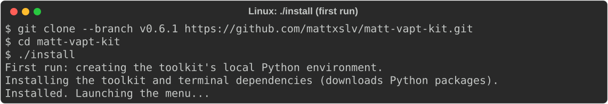
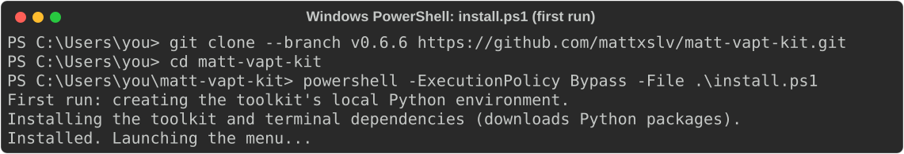
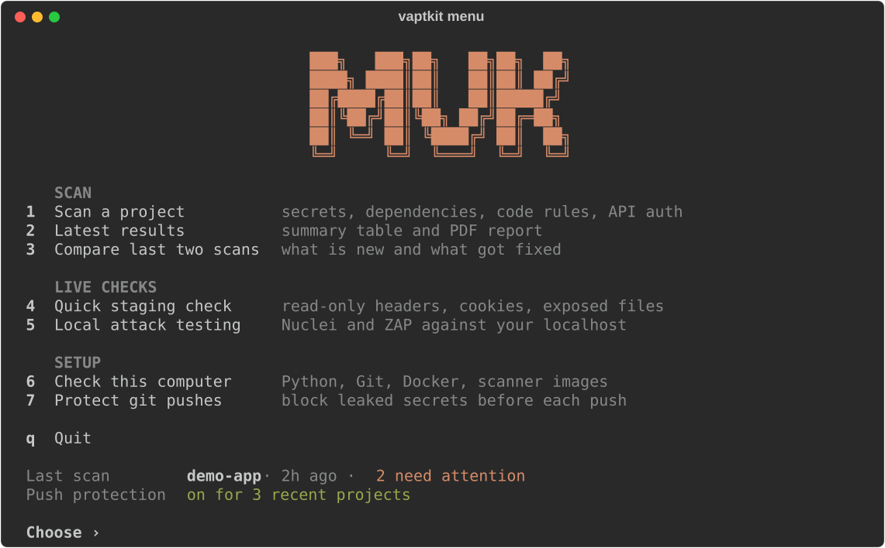
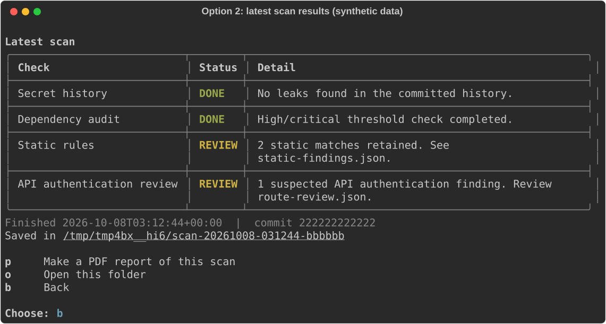
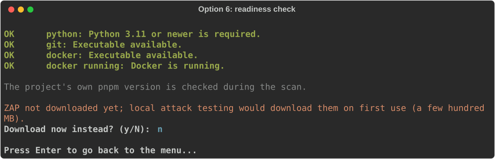
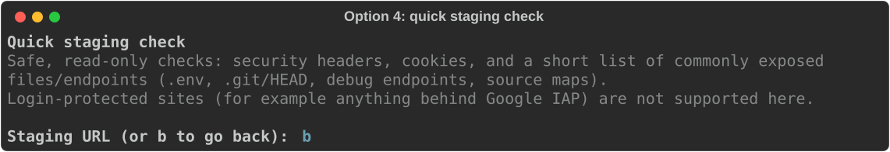
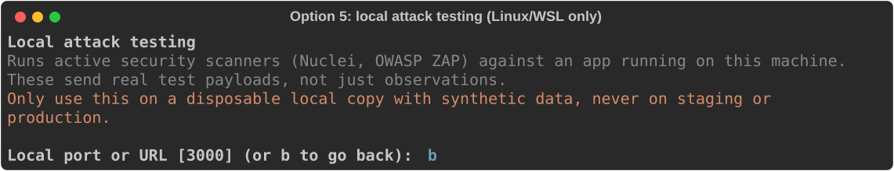
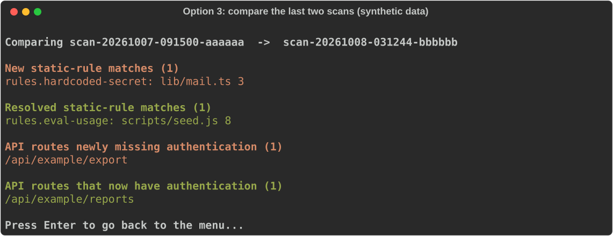

# Matt VAPT Kit

[](https://github.com/mattxslv/matt-vapt-kit/actions/workflows/test.yml)

**Scoped security checks for staging, with private evidence you can review.**

Matt VAPT Kit (MVK) combines committed-code checks, approval-bound assessments and
HTML/PDF reporting in a local Python CLI. Checks are rule-based, with no AI service
calls. It is built to help a development team find and investigate issues before
an external vulnerability assessment and penetration test.

> [!IMPORTANT]
> **Private, supervised team pilot.** This is not a complete VAPT scanner, a
> security certification or an official CERT-PH report. A clean result means
> nothing was found in the tested scope, not that the application is secure.

[Getting started](docs/getting-started.md) |
[Assessment reference](docs/reference.md) |
[Team pilot checklist](docs/pilot-checklist.md) |
[Contributing](CONTRIBUTING.md)

## Menu

New laptop, nothing installed yet? Clone the repo and run one command.

**Linux/macOS:**

```bash
git clone https://github.com/mattxslv/matt-vapt-kit.git
cd matt-vapt-kit
./install
```



**Windows (PowerShell):**

```powershell
git clone https://github.com/mattxslv/matt-vapt-kit.git
cd matt-vapt-kit
powershell -ExecutionPolicy Bypass -File .\install.ps1
```



Python 3.11+ must already be installed and on PATH (from
[python.org](https://www.python.org/downloads/), with "Add python.exe to PATH"
checked during setup). The `-ExecutionPolicy Bypass` only applies to this one
command; it does not change your system's script policy.

> [!WARNING]
> Native Windows has not completed a teammate pilot. The menu, scans and
> reports are plain Python and are expected to work, but **local attack
> testing (menu option 5) will not work on Windows** — it relies on
> `docker run --network host`, which Docker Desktop on Windows does not
> support the way Linux does. Use WSL for full parity with the Linux
> experience, or stick to options 1-4 and 6 on native Windows.

Either way, it creates the local Python environment, installs the toolkit into
it, and opens the menu below. Running it again later just reopens the menu (it
skips reinstalling once the toolkit is already set up).

Already installed? Run `vaptkit` (or `.venv/bin/vaptkit`, `.venv\Scripts\vaptkit.exe`
on Windows, from this folder) for a numbered menu:



1. **Scan a project for vulnerabilities** — recently scanned folders are listed
   for one-key reruns, and a matching `projects/*.vapt.yml` policy is picked by
   folder name (for example `~/DTAP` uses `dtap.vapt.yml`). Evidence is saved
   under this toolkit's `.private/` directory.
2. **See the latest scan results** — the most recent scan's check table, with a
   link to its saved evidence folder.

   
3. **Check this computer is ready to scan** — local prerequisites (Python, Git,
   Docker). If Docker is running, it also checks whether the Nuclei/ZAP images
   used by local attack testing are already pulled and offers to download them
   up front, so a later attack-test run doesn't stall mid-scan on the pull.

   
4. **Quick staging check** — asks for a staging URL and your explicit
   permission, then builds a short-lived scope and approval automatically and
   runs the existing read-only header, cookie and exposed-file checks
   (`vapt run` under the hood). Sites behind a login (for example Google IAP)
   are not supported from this menu entry.

   
5. **Local attack testing** — asks for a `localhost`/`127.0.0.1` URL and runs
   Nuclei and an OWASP ZAP active scan against it in Docker, with
   `--network host` so the containers can reach your machine. It sends real
   attack payloads, so only point it at a disposable local copy of an app
   with synthetic data, never at staging or production. Each scanner runs
   with a memory cap and a time limit (10 minutes for Nuclei, 15 for ZAP) so
   a slow machine doesn't need a manual kill, and it warns first if free
   memory looks low. **Does not work on Windows** — see the warning above.

   
6. **Compare the last two scans** — diffs `static-findings.json` and
   `route-review.json` between the two most recent `.private/scan-*` folders,
   reporting new/resolved static-rule matches and new/resolved API routes with
   no authentication check. Needs at least two scans to show anything.

   

Screenshots are rendered from the real menu code using synthetic scan data, not
findings from any real project.

## One command, in your terminal

There is **no web application to start**. From this toolkit folder, run:

```bash
./scan /path/to/your-project
```

For example, `./scan ~/DTAP`. Use the same command in **VS Code > Terminal > New
Terminal** with a Bash terminal. The launcher prepares the local Python environment
on first use, then runs the supported committed-code checks in order:

1. Secret-history scanning with containerized Gitleaks.
2. Dependency auditing for projects with a supported root pnpm manifest.
3. Bundled static-analysis rules with containerized Semgrep.
4. Offline Next.js API authentication review.

You get live stage headings, progress indicators, readable tool output and a final
status table. A problem in one stage does not hide the results from other independent
checks. Static matches are grouped by rule with at most three example locations,
not hundreds of code snippets. Private `summary.json`, `static-findings.json` and
`route-review.json` files go under a new
`.private/scan-*` directory. Existing evidence is never overwritten.
The static evidence lists all matched locations without raw source snippets.

**Requirements:** Python 3.11+, Git and Docker. Docker must be running; Node audits
also require the exact pnpm version declared by the project. First-time setup and
missing Docker images require downloads. pnpm audit sends dependency metadata to npm.
No system-wide Python install or Docker socket mount is needed.

For project-specific route policies:

```bash
./scan ~/DTAP --config projects/dtap.vapt.yml
```

| Terminal status | Meaning |
|---|---|
| `DONE` | That stage finished; read its detail for applicability and limits |
| `REVIEW` | Findings or a tool error need attention; inspect the terminal output and saved evidence |
| `NOT RUN` | Missing prerequisites or unsupported coverage, not a pass |

This command checks **committed HEAD**, not unsaved/dirty files. It does not install
Git hooks, change application code, provision cloud resources or start a live scan.
It does not claim to check every vulnerability. Live staging checks remain separate,
with explicit [scope approval](docs/pilot-checklist.md).

If the CLI is already installed, `vapt scan /path/to/your-project` does the same work.
Use `NO_COLOR=1 ./scan /path/to/your-project` for uncolored output. Redirected output
has no animated spinner.
The terminal shows a shield icon beside an MVK wordmark, the tagline
**"anti vince vulnerability" / "to prevent spilling the beans :D"**,
and a one-word loading status such as `✻ Topsy-turvying… (37s · Static rules)`,
picked from 60 words, with the actual task and elapsed time and no loading bar or
invented percentages. The scan ends with a line like
`✻ Cooked for 2m 5s · done 3:46 PM · 0 completed · 4 need attention` and a
plain-English `※ recap:` of what was found and what to look at first.
There are no artificial delays.
The header switches to a compact wordmark in narrow terminals. Scan details stay
left-aligned for readability, and the final summary has rounded borders and row
separators. Run metadata and saved evidence use aligned label/value columns.
Use `./scan /path/to/your-project --plain` for no colors or motion, or set
`MVK_REDUCED_MOTION=1` to disable animation while keeping colors.
Repository/evidence directories and generated result files are clickable OSC 8
links in supporting terminals. Use your terminal's open-link gesture, often
Ctrl+click. Unsupported terminals still show the path; remote-session links refer
to the remote filesystem and might not open on your desktop.
`--plain` and redirected output omit terminal hyperlinks.

If Semgrep reports processing errors, successfully returned matches are still
saved and summarized. The static stage stays **REVIEW**, and its JSON records
sanitized error types and the scanner exit code rather than raw source/error text.

## What you can do

| Capability | Scope |
|---|---|
| Check committed code | Gitleaks history checks, pnpm dependency audits and optional bundled Semgrep rules |
| Assess approved staging paths | Header-policy checks, repeat verification and opt-in bounded public-exposure checks |
| Compare endpoint permissions | Isolated DTAP test-account sessions, allowed-role controls and conservative response evidence |
| Access IAP-protected staging | Interactive browser login or an explicitly provisioned keyless service account |
| Review API authentication | Offline, heuristic review of committed Next.js route handlers |
| Review Cloud Armor configuration | Read-only Cloud Run/backend/policy metadata, with explicit association and coverage gaps |
| Produce private reports | Self-contained HTML, optional PDF and sanitized evidence figures |
| Exercise the detector locally | HTTPS fixtures, ownership/workflow, browser XSS and real ModSecurity/CRS labs, plus a separate release challenge |

Live role testing currently supports **DTAP's cookie-login contract only**.
Record ownership, workflow and XSS checks are local-lab capabilities, not live
assessment features. Bundled ZAP/Nuclei containers are dormant tools, not integrated
scan runners or scheduled jobs.

See [Cloud Armor and XSS](docs/cloud-armor-and-xss.md) for the new modules' commands,
evidence requirements and limits. WAF configuration is not proof of application safety.
The [local WAF lab](docs/cloud-armor-and-xss.md#local-modsecurity-and-owasp-crs-lab)
verifies real request blocking without GCP resources; it does not verify Cloud Armor.

## Step-by-step: use it in your terminal or VS Code

This walkthrough uses **Linux/Bash** (Windows users: run it in WSL, or adapt the
commands to PowerShell), Python **3.11+**, Git and access to this
private repository. It creates a **sample report only**. You do not need Docker,
Google credentials or a DTAP password, and it does not scan your application.

### Step 1: open a terminal and enter the repository

In **VS Code**, choose **Terminal > New Terminal** and use a Bash terminal.
In an ordinary terminal, use the same commands.

If you have not cloned the repository:

```bash
git clone https://github.com/mattxslv/matt-vapt-kit.git
cd matt-vapt-kit
```

If you already have it, open that folder in VS Code or enter its existing location,
for example `cd ~/matt-vapt-kit`. Run the remaining commands from this folder.

### Step 2: install once and enable the short commands

Run the installer from the [Menu](#menu) section (`./install`, or `install.ps1`
on Windows). It opens the menu when done; press `q` to quit it. Then activate
the environment so the short commands work:

```bash
source .venv/bin/activate        # Windows PowerShell: .venv\Scripts\Activate.ps1
```

Now use **`vapt`** and **`vaptkit`** instead of typing `.venv/bin/vapt` every time.
Activate it again whenever you open a new terminal.

Prefer doing it by hand? `python3 -m venv .venv`, activate it, then
`python -m pip install -e .` is exactly what the installer does.

### Step 3: check that your local setup works

```bash
vapt --version
vapt doctor --for html
vapt validate templates/project.example.yml
```

| Output | What it means |
|---|---|
| `ready: true` | Your environment can generate HTML reports |
| `configuration: valid` | The example YAML has the correct format |
| `scan_authorized: false` | Expected: this example does not authorize a live scan |

**None of these commands scans DTAP or finds new vulnerabilities.**

### Step 4: generate the sample report

```bash
mkdir -p .private
chmod 700 .private
vapt report tests/fixtures/assessment.json \
  --reviewed --html-only --output .private/demo-report
```

Expected output: `Report written to .private/demo-report/report.html`.
This means the file was created successfully. **It does not open automatically.**
If that output folder already exists, choose another name such as
`.private/demo-report-002`; the toolkit never overwrites existing evidence.

### Step 5: open the report in a browser

On a Linux desktop:

```bash
xdg-open .private/demo-report/report.html
```

Alternatively, open the HTML file using your browser's **Open File** command.
In VS Code, the file is at `.private/demo-report/report.html`; opening it in the
editor shows HTML source, not necessarily the rendered report. For a remote/SSH
workspace, download the file and open it on your local computer.

The report must say **SYNTHETIC EXAMPLE**. These are demonstration findings, not
results from your system.

### Step 6: choose what you actually want to check

| Your goal | Follow this guide |
|---|---|
| Check committed code or install automatic pre-push checks | [Code and Git checks](docs/reference.md#push-checks-no-prs) |
| Run a real staging header or DTAP role assessment | [Staging walkthrough and approvals](docs/pilot-checklist.md#run-only-the-approved-scope) |
| Generate PDF reports or troubleshoot setup | [Full setup guide](docs/getting-started.md) |
| Exercise XSS or WAF detection without cloud resources | [Local labs](docs/cloud-armor-and-xss.md) |

For a real assessment, `report` is the **last** step. First run an approved
assessment with `vapt run` or `vapt roles`, then review and export its JSON.
Running `report` against the sample fixture never tests your application.

**Next time you open the terminal:**

```bash
cd ~/matt-vapt-kit
source .venv/bin/activate
vaptkit          # the menu; or vapt --help for the raw CLI
```

Or skip activation entirely: `./install` (or `install.ps1`) reopens the menu
without reinstalling.

Use your actual checkout path if it is elsewhere. No VS Code extension or AI
skill is required. `deactivate` leaves the Python environment when you are done.

For a configured pilot, `vapt doctor --for roles --config .private/project.yml`
checks the relevant local dependencies. `vapt roles --prompt-passwords` supports
hidden entry of missing QA passwords; approvals and QA email configuration are
still required. Saved assessment summaries clearly separate findings from coverage
gaps and unconfirmed cleanup.

## Move from local practice to staging

1. **Define the scope.** Verify the exact staging origin, owner, permitted paths,
   expected role policy and possible login side effects.
2. **Create a fresh approval.** The CLI binds it to the configuration digest and a
   short time window. A project YAML file alone never authorizes a run.
3. **Run and review.** Keep credentials and evidence private. Investigate findings,
   coverage gaps and unconfirmed session cleanup.

Follow the [team pilot checklist](docs/pilot-checklist.md) before a live run.
Gateway access and application test-account access are separate requirements.
The toolkit does not provision IAM, disable IAP, change an application or deploy it.

## Read the result, not just the finding count

| Result | Meaning |
|---|---|
| Confirmed finding | The check's evidence criteria were met; its stated scope still applies |
| Suspected finding | Supporting evidence is incomplete and needs review |
| Tested cell | The specified allowed, denied or violation criteria were assessed |
| Blocked / inconclusive | Access or evidence was insufficient; this is not a passing check |
| Not run / unsupported | No assessment was performed for that area |

Local benchmarks and a narrow live staging pilot support supervised use. They do
not establish a real-world accuracy percentage, full OWASP coverage or an absence
of historical data leaks. See the [benchmark limitations](docs/reference.md#accuracy-benchmark-and-limitations).

## Repository map

| Location | Purpose |
|---|---|
| [`vaptkit/`](vaptkit/) | CLI, scope validation, checks, access adapters and reporting |
| [`tests/`](tests/) | Routine local regressions and synthetic fixtures |
| [`release_tests/`](release_tests/) | Separately executed, versioned challenge cases |
| [`projects/`](projects/) | Internal project configurations, not standing approvals |
| [`templates/`](templates/) | Safe starter configuration and application CI template |
| [`docs/`](docs/) | Setup, team-pilot procedure and detailed reference |
| [`.github/workflows/`](.github/workflows/) | Toolkit checks and release challenge; no live target scans |

## Working on the toolkit

```sh
.venv/bin/python -m unittest discover -s tests -v
PYTHONPATH=tests .venv/bin/python -m unittest discover -s release_tests -v
```

OpenSSL is required for local HTTPS coverage. The optional Juice Shop benchmark
uses an isolated Docker container and is not part of the default run.
See [contributing](CONTRIBUTING.md) for the full workflow.

Keep credentials, approvals, reports and browser profiles out of Git. Do not post
sensitive findings in public channels. See [security and evidence handling](SECURITY.md).
