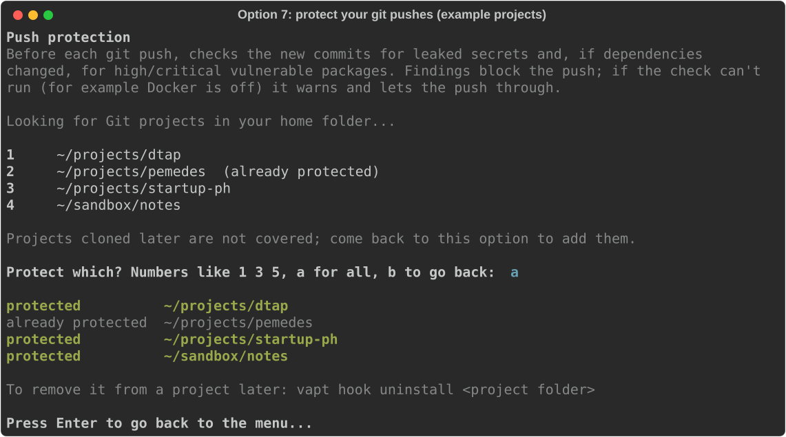

<p align="center">
  
</p>

<p align="center">
  <a href="https://github.com/mattxslv/matt-vapt-kit/actions/workflows/test.yml"></a>
  <a href="https://github.com/mattxslv/matt-vapt-kit/actions/workflows/weekly-scan.yml"></a>
  
  
  
</p>

**Security checks for the team's projects, with private evidence and PDF reports.**
Rule-based, no AI service calls. Built to find and fix issues before an external
VAPT.

> [!IMPORTANT]
> **Private, supervised team pilot.** Not a complete VAPT scanner, a certification
> or a CERT-PH report. A clean result means nothing was found in the tested scope,
> not that the application is secure.

## Install

Needs Python 3.11+ on PATH and Docker running. Clone, then run one command:

```bash
git clone https://github.com/mattxslv/matt-vapt-kit.git
cd matt-vapt-kit
./install
```


On Windows (PowerShell), the last line is
`powershell -ExecutionPolicy Bypass -File .\install.ps1` (the bypass applies to that
command only).


The first run sets everything up (including the PDF tools, a one-time ~150 MB
download), asks which of your Git projects to protect on every push, then opens the
menu. Afterwards, `./install` or `vaptkit` just opens the menu.

> [!WARNING]
> Windows has not completed a teammate pilot yet; its Docker handling was only
> tested on Linux. Option 5 reaches your app as `host.docker.internal`, which some
> dev servers reject (Vite needs `server.allowedHosts: ['host.docker.internal']`).

## The menu


1. **Scan a project:** secrets in Git history, vulnerable dependencies (Node, PHP,
   Python and more), code rules (JavaScript/TypeScript and PHP/Laravel) and Next.js
   API routes without a login check. Projects with a standing approval (DTAP)
   also get read-only checks of their staging site. Ends with an optional PDF report.
2. **Latest results:** the last scan's table; `p` makes a PDF.

   
3. **Compare last two scans:** what's new and what got fixed.

   
4. **Quick staging check:** paste any staging URL for read-only header, cookie and
   exposed-file checks. Asks for permission first; login-protected sites aren't
   supported.

   
5. **Local attack testing:** Nuclei and ZAP against an app on your own machine,
   kept to the port you enter. Sends real attack payloads, so use a disposable
   local copy, never staging or production.

   
6. **Check this computer:** Python, Git, Docker and the scanner images.

   
7. **Protect git pushes:** finds your projects and checks only the new commits
   before each `git push`. New leaked secrets or high/critical vulnerable packages
   block the push; if the check can't run, it warns and lets it through.
   `git push --no-verify` skips it in an emergency.

   

Screenshots use the real menu code with made-up data, never real findings.

## Reading results

| Status | Meaning |
|---|---|
| `DONE` | That check finished; read its detail for limits |
| `REVIEW` | Findings, or a tool error, to look at |
| `NOT RUN` | A coverage gap, not a pass |

Everything is saved privately under `.private/` and never overwritten. Findings are
*suspected* until a person confirms them.

## Automatic checks

- **Weekly scan:** every Monday 08:00 PHT, GitHub Actions scans DTAP, PEMEDES and
  Startup PH from this repo (nothing is committed to the app repos) and uploads a
  PDF for each. Results: **Actions → Weekly security scan**. Needs the
  `SCAN_REPOS_TOKEN` secret, a read-only token for those repos.
- **Live staging:** `projects/<name>.standing-approval.yml` records the owner's
  approval and an expiry date. While it's valid, scans of that project add the
  read-only staging checks with no prompts; each run still gets its own one-hour
  approval.

## Without the menu

```bash
./scan ~/DTAP                      # same scan, no install needed
vapt scan ~/DTAP --pdf             # with the CLI installed, plus a PDF
vapt --help                        # every command
```

## More

[Getting started](docs/getting-started.md) ·
[Reference](docs/reference.md) ·
[Team pilot checklist](docs/pilot-checklist.md) ·
[Cloud Armor and XSS labs](docs/cloud-armor-and-xss.md) ·
[Contributing](CONTRIBUTING.md) ·
[Security and evidence handling](SECURITY.md)

Run the toolkit's own tests with `.venv/bin/python -m unittest discover -s tests`.
Keep credentials, reports and approvals out of Git and public channels.
